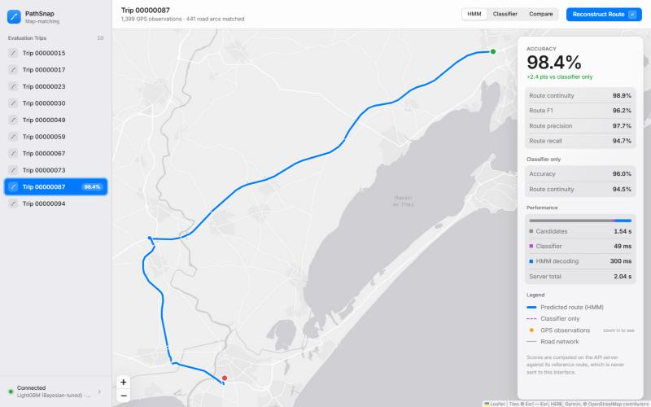
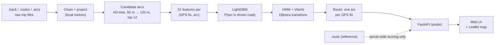

<div align="center">

# PathSnap

**Machine-learning map-matching and route reconstruction for noisy GPS trajectories**


-2E7D32)


UE24CS352A Machine Learning · PathSnap hackathon · PES University, RR Campus

</div>

---

GPS fixes drift onto parallel streets, jump across buildings and drop out. PathSnap snaps a
~1 Hz GPS trace back onto the road network in two stages:

1. **Candidate scoring.** For every GPS fix, the nearby road arcs become candidates. A gradient-boosted
   classifier estimates the probability that each candidate is the road actually driven.
2. **Sequence decoding.** A Hidden Markov Model combines these probabilities with road-network
   connectivity. Viterbi decoding then picks the most likely *connected* route.

The trained pipeline runs as a **FastAPI** service. A macOS-style **web UI** lets the evaluator pick a trip,
compare predicted routes on a map, and view its scores. Both services can run on one laptop or across two laptops.

The frozen pipeline reached **95.89% pointwise accuracy** across **10 evaluator trips**.
[Final evaluation](#final-evaluation-10-evaluator-test-trips) ·
[Team handoff and crash course (PDF)](docs/PathSnap-Team-Handoff.pdf) ·
[Editable handoff](docs/PathSnap-Team-Handoff.md)

<p align="center"></p>

## Headline results (10 student-test trips, never used for training)

| | Classifier only | **Classifier + HMM** |
|---|---|---|
| Pointwise accuracy (observation-weighted) | 90.0 % | **94.3 %** |
| Route continuity | 94.4 % | **97.9 %** |
| Route F1 (traversed-arc set vs reference) | 90.4 % | **93.5 %** |
| Trips with accuracy ≥ 95 % | 3 / 10 | **6 / 10** |
| Pipeline time per trip (laptop CPU) | | **0.1–1.7 s** |

All numbers come from `reports/` and can be regenerated with the scripts below.

## Final evaluation: 10 evaluator-test trips

All 10 reserved evaluator trips were run through the deployed API (`POST /predict`) with the
frozen model and decoder. Nothing was retrained or tuned on them, and scoring against their
reference routes happened server-side.

| | Classifier only | **Classifier + HMM** |
|---|---|---|
| Pointwise accuracy (observation-weighted, 19,674 fixes) | 91.25% | **95.89%** |
| Route continuity (trip mean) | 93.40% | **96.43%** |
| Route F1 (trip mean) | 87.71% | **90.91%** |
| Trips with accuracy ≥ 95 % | 5 / 10 | **7 / 10** |
| Trips where the HMM beats the classifier | | **9 / 10** |
| Total server time, all 10 trips | | **12.2 s** |

| Trip | Fixes | Classifier | **HMM** | Continuity | Route F1 |
|---|---|---|---|---|---|
| 00000015 | 6,854 | 83.1 % | **94.9 %** | 99.8 % | 88.7 % |
| 00000017 | 1,346 | 93.9 % | **93.1 %** | 87.0 % | 84.9 % |
| 00000023 | 458 | 94.3 % | **95.9 %** | 98.7 % | 88.1 % |
| 00000030 | 654 | 83.5 % | **88.7 %** | 91.4 % | 80.9 % |
| 00000049 | 2,642 | 99.3 % | **99.6 %** | 99.4 % | 98.0 % |
| 00000059 | 1,031 | 96.4 % | **96.6 %** | 93.0 % | 86.1 % |
| 00000067 | 916 | 96.4 % | **96.5 %** | 99.1 % | 94.2 % |
| 00000073 | 1,144 | 98.6 % | **98.7 %** | 99.1 % | 97.6 % |
| 00000087 | 1,399 | 96.0 % | **98.4 %** | 98.9 % | 96.2 % |
| 00000094 | 3,230 | 94.2 % | **95.1 %** | 97.9 % | 94.3 % |

The evaluator accuracy of 95.89% compares with 94.31% on the student-test split.
On trip 00000017, decoding lowered pointwise accuracy by 0.82 percentage points while
improving continuity from 85.28% to 86.99%. [View the prediction map](reports/evaluator_test/maps/pred_00000017.html).

The evaluation was run twice, independently, and the two runs agree to every digit (same model
checksum `c391c21d…`):

| Run | How | Reproduce | Evidence in `reports/evaluator_test/` |
|---|---|---|---|
| Through the deployed API | `GET /trips` then `POST /predict` for each trip, as the UI does | start the API on the evaluator data, then run `python scripts/07_evaluator_run.py` | `results.csv`, `summary.json`, `maps/pred_<trip>.html` |
| Offline, direct pipeline | loads the committed artifacts and scores after prediction | `python scripts/evaluate_dataset.py --data data/evaluator_test --output data/evaluator_rerun` | `RESULTS.md`, `per_trip.csv`, `summary.csv`, `provenance.json` (input and artifact SHA-256, runtime versions) |

The maps show GPS, road network and prediction only; the reference route is not drawn. Raw
evaluator data stays git-ignored.

---

## Contents

- [How it works](#how-it-works)
- [Dataset](#dataset)
- [Experiments](#experiments)
- [Repository layout](#repository-layout)
- [Quick start](#quick-start)
- [Two-laptop deployment](#two-laptop-deployment)
- [API reference](#api-reference)
- [Evaluation integrity](#evaluation-integrity)
- [Team](#team)

## How it works



| Stage | What happens | Code |
|---|---|---|
| Cleaning | Drop non-finite or out-of-range fixes; sort by time; remove duplicate timestamps | `src/pathsnap/io.py` |
| Projection | Local equirectangular frame in metres around each trip (distortion < 0.1 % at city scale) | `src/pathsnap/geo.py` |
| Road network | Corridor pruning, KD-tree over arc points sampled every 8 m, Dijkstra with cutoff | `src/pathsnap/network.py` |
| Labels | Monotone dynamic programme aligning `.route` arcs to GPS fixes (training and scoring only) | `src/pathsnap/labels.py` |
| Features | Distance and rank, Gaussian prior, heading vs arc bearing, speed, time gaps, ±3-fix context distance, arc length, projection position, node degrees, two-way flag | `src/pathsnap/features.py` |
| Classifier | Bayesian-tuned LightGBM, binary *is-reference-arc* | `src/pathsnap/models.py`, `scripts/04_bayes_opt.py` |
| Decoder | States = candidate arcs; emissions = renormalised classifier probabilities; transitions = exp(−\|d<sub>network</sub> − d<sub>GPS</sub>\| / β√Δt); chain restarts at disconnected steps | `src/pathsnap/hmm.py` |

## Dataset

| Partition | Trips | GPS fixes | Use |
|---|---|---|---|
| Train | 80 | 208,417 | fitting, cross-validation, Bayesian optimisation, decoder tuning |
| Student test | 10 | 19,160 | development-stage comparison |
| Evaluator test | 10 | 19,674 | final evaluation with the committed model and decoder |

Things we found while exploring the data (`scripts/01_eda.py`, `reports/eda/`):

- **Sampling.** 94 % of steps are exactly 1 s apart. Some trips have large gaps, up to 42 h within one trip (trip 90).
- **Per-trip road networks.** Each trip ships its own network (24k nodes and 48k arcs on average in train) with no isolated nodes. Arc ids only mean something within their own trip.
- **Imperfect reference routes.** On trips 33 and 54 the reference route sits a median 120–140 m away from the GPS track. We treat these as label errors: observations more than 60 m from their aligned reference arc are left out of training.
- **Candidate recall.** The reference arc appears in the candidate set for 99.8 % of student-test fixes (candidate miss rate 0.2 %).

## Experiments

### Seven candidate classifiers

Protocol: 5-fold `GroupKFold` grouped by trip on the 80 training trips, then a refit on all of them and
evaluation on the 10 student-test trips. Macro F1 and log loss are measured on candidates. Top-1 is
measured per observation.

| Model | Family | CV Macro F1 | CV Top-1 | Test Top-1 | Test Macro F1 | Log loss | Route continuity |
|---|---|---|---|---|---|---|---|
| **LightGBM** | Boosting | 0.940 ± 0.016 | 0.894 | **0.900** | **0.938** | 0.070 | 0.941 |
| Random Forest | Bagging ensemble | 0.940 ± 0.016 | 0.895 | 0.895 | 0.936 | 0.068 | 0.937 |
| MLP (64-32) | Neural network | 0.936 ± 0.016 | 0.893 | 0.888 | 0.933 | 0.072 | 0.941 |
| Decision Tree | Tree | 0.932 ± 0.018 | 0.886 | 0.888 | 0.930 | 0.083 | 0.933 |
| Logistic Regression | Linear | 0.934 ± 0.015 | 0.890 | 0.885 | 0.930 | 0.088 | 0.933 |
| KNN (k = 25) | Instance-based | 0.933 ± 0.015 | 0.884 | 0.879 | 0.927 | 0.112 | 0.925 |
| Gaussian NB | Probabilistic | 0.900 ± 0.013 | 0.868 | 0.857 | 0.887 | 0.449 | 0.917 |

**Why LightGBM.** It is statistically tied with Random Forest in cross-validation. It is best on
student-test Top-1 and Macro F1, its probabilities are well calibrated for the HMM, and it trains on all
1.37 M rows in about 20 s, against about 100 s for Random Forest. Plots: `reports/figures/cmp_*.png`.
Confusion matrices: `cm_*.png`. MLP training curve: `mlp_training_curve.png`.

### Bayesian hyper-parameter optimisation

We ran Optuna's TPE sampler for 30 trials. The objective was mean 3-fold `GroupKFold` Top-1, and the
search covered 8 hyper-parameters (trees, learning rate, leaves, minimum child samples, row and column
subsampling, L1 and L2 regularisation).

| | CV Macro F1 | CV Top-1 | Test Top-1 | Test Macro F1 | Log loss |
|---|---|---|---|---|---|
| LightGBM untuned | 0.9396 | 0.8943 | 0.9001 | 0.9382 | 0.0696 |
| **LightGBM tuned** | **0.9404** | **0.8969** | **0.9002** | **0.9384** | **0.0662** |

The gain is small but consistent. The clearest improvement is in log loss, which matters because
the decoder consumes these probabilities. The full trial log is in `reports/bayes_opt_trials.csv`.

### HMM decoder

The decoder was tuned on 12 *held-out training trips*, scored with a classifier that never saw them.
Viterbi's arg-max depends only on the product β × emission weight: a first 5 × 3 grid gave identical
accuracy for equal products (`reports/hmm_tuning_grid_beta_x_w.csv`). The final search therefore runs
over β alone, from 0.125 to 32. Accuracy peaks at β = 1, in the middle of that range
(`reports/hmm_tuning.csv`). Per-trip comparisons and interactive maps are in
`reports/hmm_vs_classifier.csv` and `reports/maps/pred_<trip>.html`.

## Repository layout

```
PathSnap/
├── src/pathsnap/          core library (io, geo, network, labels, features, models, metrics, hmm, pipeline, viz)
├── scripts/               analysis, training, evaluator runs, and Windows launchers
├── api/main.py            FastAPI backend   (Laptop 1)
├── ui/web/               web UI: index.html, styles.css, app.js   (Laptop 2)
├── ui/serve.py            serves the web UI (standard library only)
├── ui/app.py              Streamlit UI (fallback)
├── artifacts/             final_model.joblib · final_model_meta.json · hmm_config.json
├── reports/               result CSVs, experiment log, figures/, maps/ (Folium HTML), eda/, RESULTS.md
├── docs/                  screenshot, team handoff, and verified Windows dependencies
├── requirements.txt
└── TEAM.md                ownership and viva checklist
```

## Quick start

The trained model and HMM configuration are included. Setup was verified on Windows with Python 3.13.2.

```powershell
git clone git@github.com:sidd2006/PathSnap.git
cd PathSnap
python -m venv .venv
.\.venv\Scripts\python.exe -m pip install -r requirements.txt
.\.venv\Scripts\python.exe scripts\show_results.py all
```

For exact package versions, see the [verified Windows environment](docs/requirements-windows-tested.txt).
On Linux/macOS, use `.venv/bin/python` for the virtual environment's Python.

For a local demo, extract the organiser ZIP so each trip is in `data/evaluator_test/<trip_id>/`
with its `.track`, `.nodes`, `.arcs`, and `.route` files. Run
[Start-API.cmd](scripts/windows/Start-API.cmd), then [Start-Web-UI.cmd](scripts/windows/Start-Web-UI.cmd),
which opens the [web UI](http://localhost:8080). [API docs](http://127.0.0.1:8000/docs) are on the API.
The Streamlit fallback UI is still available through [Start-UI.cmd](scripts/windows/Start-UI.cmd).
The API launcher accepts an alternate trip directory as its first argument. Use
[Show-Model-Stats.cmd](scripts/windows/Show-Model-Stats.cmd) to display saved results.

### Reproduce the original training experiments

Place the original organiser training and student-test data like this:

```
data/train/<trip_id>/<trip_id>.{track,nodes,arcs,route}
data/student_test/<trip_id>/<trip_id>.{track,nodes,arcs,route}
```

Reproduce every result. Seeds are fixed at 42. Runtimes are for a 6-core laptop CPU; no GPU is needed.

```bash
python scripts/01_eda.py               # ~1 min   dataset inventory, plots, EDA Folium map
python scripts/02_build_features.py    # ~1 min   candidate + feature tables  -> cache/
python scripts/03_train_models.py      # ~35 min  7 models, CV + student test -> reports/model_comparison.csv
python scripts/04_bayes_opt.py         # ~30 min  Optuna TPE                  -> artifacts/final_model.joblib
python scripts/05_hmm_eval.py          # ~8 min   decoder tuning + comparison -> artifacts/hmm_config.json
python scripts/06_results_summary.py   # seconds  reports/RESULTS.md
```

The trained model and decoder config are already committed, so you can skip straight to deployment.

## Two-laptop deployment

**Laptop 1: model + API**

```powershell
$env:PATHSNAP_EVAL_DIR = (Resolve-Path 'data/evaluator_test').Path
.\.venv\Scripts\python.exe -m uvicorn api.main:app --host 0.0.0.0 --port 8000
```

Find the LAN IP with `ipconfig` and allow port 8000 through Windows Defender Firewall. Every request is
logged in this terminal; show it to the evaluator:

```
INFO | POST /predict trip=00000056 : obs=3958  HMM acc=0.9576  classifier acc=0.9179  continuity=0.9656  route F1=0.9346  (2.12s)
```

**Laptop 2: UI**

```powershell
.\.venv\Scripts\python.exe ui\serve.py --api http://<laptop-1-ip>:8000
```

or `scripts\windows\Start-Web-UI.cmd http://<laptop-1-ip>:8000`. The browser opens at
`http://localhost:8080`. The web UI needs nothing beyond Python's standard library; the map library
and basemap load from the internet. The API address can also be changed in the UI, from the
connection status at the bottom of the sidebar.

| Area | What it does |
|---|---|
| Sidebar | the 10 evaluation trips from `GET /trips`; each shows its accuracy once reconstructed |
| Toolbar | **Reconstruct Route** sends `POST /predict`; the HMM / Classifier / Compare control switches route layers |
| Map | road network, GPS fixes (shown once they are far enough apart on screen), predicted route, start and end |
| Inspector | accuracy and gain over the classifier, continuity, route F1/precision/recall, per-stage timing |

Keyboard: `↑` / `↓` choose a trip, `Enter` reconstructs, `1` `2` `3` switch layers. Light and dark mode
follow the operating system. If you prefer Streamlit:
`$env:PATHSNAP_API='http://<laptop-1-ip>:8000'; .\.venv\Scripts\python.exe -m streamlit run ui/app.py`. To check the API from either laptop:
`python scripts/api_smoke_test.py http://<laptop-1-ip>:8000`.

## API reference

| Method | Path | Body | Returns |
|---|---|---|---|
| `GET` | `/health` | | status, loaded model, decoder config |
| `GET` | `/trips` | | `{"trips": [ids…]}` |
| `POST` | `/predict` | `{"trip_id": "00000056"}` | GPS fixes, predicted route and classifier-only route polylines, nearby road network, predicted arc per fix, server-side metrics, decoder diagnostics, timing |

Interactive docs are served at `http://<host>:8000/docs`.

## Evaluation integrity

- **No trip leakage.** Trips never cross partitions, and all cross-validation is grouped by trip.
- **No test-driven choices.** The features, model, hyper-parameters and decoder β were all chosen
  using only the training and student-test trips.
- **Labels stay on the server.** `pipeline.predict_trip` never reads `.route`. The API loads the
  reference route only *after* predicting, uses it only to compute the score, and never sends it to the UI.
- **No hard-coding.** No trip ids, routes or predictions appear anywhere in the code; every request runs
  the full pipeline.

## Team

| Member | GitHub | Owns |
|---|---|---|
| Shryes | [@Shryes19](https://github.com/Shryes19) | data loading, cleaning, EDA, results summary |
| Shubham Bhat | [@Shubhambhat06](https://github.com/Shubhambhat06) | road network, candidate generation, labelling, feature engineering |
| Siddhant Anil | [@SiRex750](https://github.com/SiRex750) | model zoo, metrics, model comparison, Bayesian optimisation |
| Siddhant Khurdiya | [@sidd2006](https://github.com/sidd2006) | HMM/Viterbi, inference pipeline, FastAPI, web UI, deployment |

Branch-by-branch ownership and each member's viva checklist are in [TEAM.md](TEAM.md).

### AI-assistance disclosure

Parts of this codebase were written with an AI coding assistant (Claude). Commits that contain
AI-assisted work carry a `Co-Authored-By: Claude` trailer. Every experiment was actually run, and
every number in this README and in `reports/` comes from those runs. Each member has reviewed the part
listed for them in TEAM.md and can explain it.
